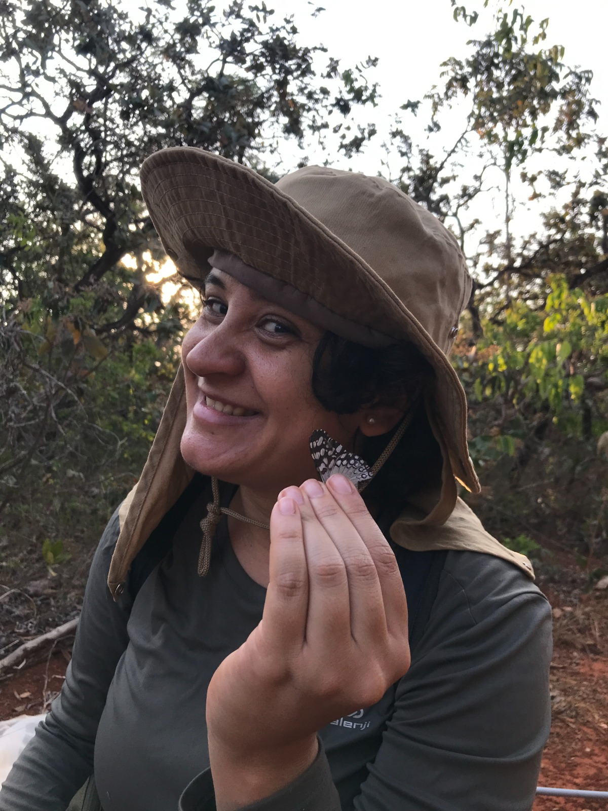

{.portrait fig-alt="Portrait"}

::: lead
I am an evolutionary ecologist interested in understanding how organisms are shaped by environmental factors, with a particular focus on thermal ecology, thermoregulatory traits, and animal behavior. My research explores how environmental variation influences organismal responses, adaptations, and ecological patterns. I hold a Master's degree in Psychobiology from the Federal University of Rio Grande do Norte (UFRN), with expertise in thermal ecology, meta-analysis, and animal behavior. My research interests also include comparative approaches, ecological and evolutionary patterns, and the use of quantitative methods to investigate organism-environment interactions.
:::

## Research interests

-   Thermal Ecology and Thermoregulation: Thermoregulatory strategies and the role of wing optical properties in thermal balance and temperature regulation in butterflies and other insects.

-   Evolutionary Ecology: Evolutionary patterns, trait evolution, and phylogenetic comparative methods to investigate how environmental factors shape organismal traits.

-   Animal Behavior: Behavioral assessment and the investigation of behavioral responses to environmental variation.

-   Community Ecology and Insect–Plant Interactions: Ecological communities, species interactions, and the relationships between insects and plants.

## Find me

[Lattes](http://lattes.cnpq.br/466296823518334) · [ORCID](https://orcid.org/0000-0001-7200-7269) · [Google Scholar](https://scholar.google.com/citations?user=Ewz3_XoAAAAJ&hl=en) ·
