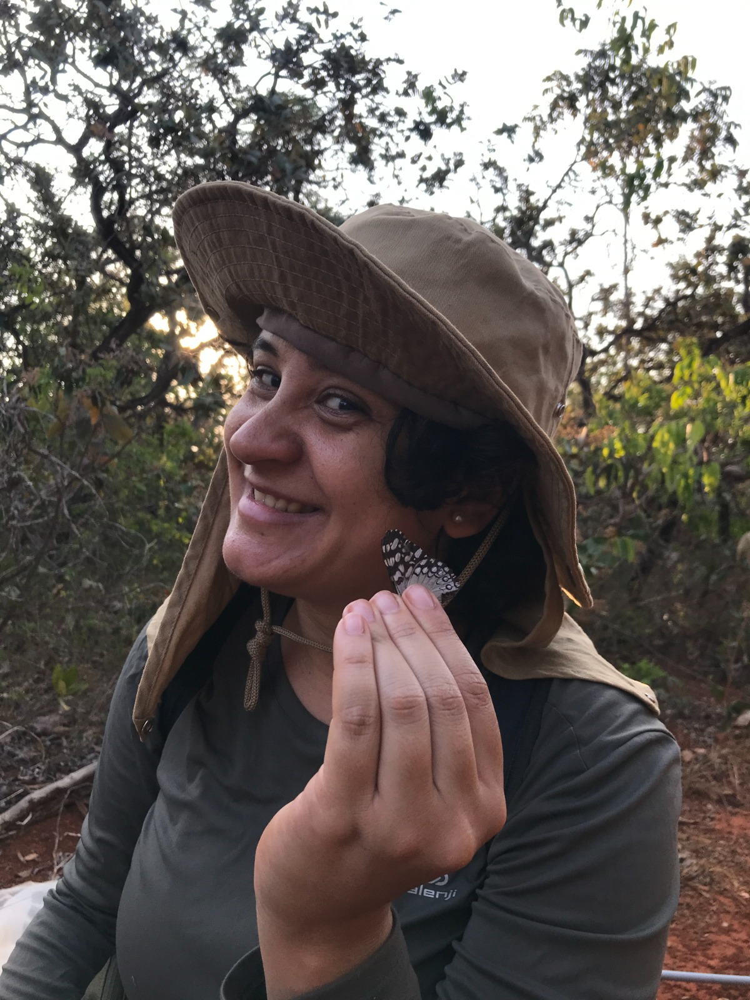

{.portrait fig-alt="Retrato"}

::: lead
Sou ecóloga evolutiva e tenho interesse em compreender como os organismos são moldados por fatores ambientais, com foco especial em ecologia térmica, características relacionadas à termorregulação e comportamento animal. Minha pesquisa investiga como a variação ambiental influencia as respostas dos organismos, seus processos adaptativos e os padrões ecológicos. Sou mestre em Psicobiologia pela Universidade Federal do Rio Grande do Norte (UFRN), com experiência em ecologia térmica, meta-análise e comportamento animal. Meus interesses de pesquisa também incluem abordagens comparativas, padrões ecológicos e evolutivos e o uso de métodos quantitativos para investigar as interações entre os organismos e o ambiente.
:::

## Interesses de Pesquisa

-   **Ecologia Térmica e Termorregulação:** Estratégias termorregulatórias e o papel das propriedades ópticas das asas no balanço térmico e na regulação da temperatura em borboletas e outros insetos.
-   **Ecologia Evolutiva:** Padrões evolutivos, evolução de características e métodos comparativos filogenéticos para investigar como os fatores ambientais moldam as características dos organismos.
-   **Comportamento Animal:** Avaliação comportamental e investigação das respostas comportamentais à variação ambiental.
-   **Ecologia de Comunidades e Interações Inseto–Planta:** Comunidades ecológicas, interações entre espécies e relações ecológicas entre insetos e plantas.

## Onde me encontrar

[Lattes](http://lattes.cnpq.br/466296823518334) · [ORCID](https://orcid.org/0000-0001-7200-7269) · [Google Scholar](https://scholar.google.com/citations?user=Ewz3_XoAAAAJ&hl=en) ·
